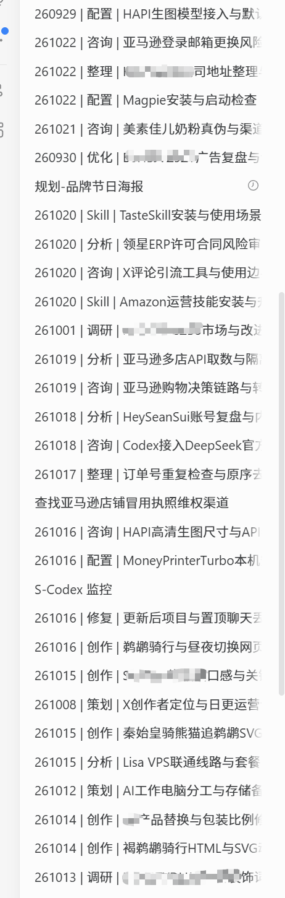

# 会话标题整理 · Conversation Title Manager

一个在 **Codex 聊天中运行**的 Skill：先了解你的项目与聊天，再帮你选择分类、统一会话标题，并按你选择的时间检查新增会话。

可在同一轮任务中处理 **Codex 桌面端 + ChatGPT 网页版**，也可以只启用其中一个。两端分别记录进度，某一端暂时无法访问时，另一端仍可继续。

**它没有独立启动窗口。** 你在 Codex 聊天中调用它，设置和结果也在聊天中展示；定时启动由 Codex 宿主的自动任务负责。

## 实际效果

下面是用户提供并授权用于展示的侧边栏截图，包含部分已按日期、分类、主题整理的会话；部分内容已由提供者遮挡。



截图展示的是**部分实际整理效果**，不是独立启动界面，也不表示全部历史会话已经改名。仍保留原名的条目，可能尚未处理或受到保护；不能仅凭这张截图判断具体原因。

## 三步开始

### 1. 安装到 Codex

下载本仓库 ZIP（页面上的 **Code → Download ZIP**），解压，将包含 `SKILL.md` 的目录重命名为 `conversation-title-manager`，放入你当前 Codex 使用的技能目录：

- 已设置 `CODEX_HOME`：`$CODEX_HOME/skills/conversation-title-manager/`
- 未设置时通常为：`~/.codex/skills/conversation-title-manager/`
- Windows 默认路径示例：`C:\Users\你的用户名\.codex\skills\conversation-title-manager\`

最终应能找到：

```text
skills/
└── conversation-title-manager/
    ├── SKILL.md
    ├── README.md
    ├── agents/
    ├── references/
    ├── scripts/
    └── docs/
```

注意不要多套一层压缩包目录。如果已经安装过，先核对维护版本，保留本地修改及包外的个人配置、处理记录。

### 2. 在 Codex 聊天中启动

直接复制发送：

```text
使用 $conversation-title-manager。
先只读扫描我的项目和聊天，推荐适合我的分类与命名方案，给我几条改名预览；先不要执行改名，也不要创建定时任务。
```

如果宿主暂时没有发现新 Skill，先核对安装路径和该版本的技能发现方式；也可以明确告诉 Codex 读取安装目录里的 `SKILL.md`。是否需要重新打开应用取决于宿主，不承诺所有版本都能即时刷新。

### 3. 选择规则和时间

首次使用会在聊天中完成：

**只读扫描 → 推荐 2–3 套方案 → 展示 3–5 条可核实的预览 → 选择规则、范围和时间 → 按授权执行。**

你可以调整：

| 设置 | 可选内容 |
| --- | --- |
| 平台 | Codex、ChatGPT 网页版，或两者一起 |
| 分类 | 按扫描结果推荐精简或细分方案，也可自行删改 |
| 标题格式 | `YYMMDD \| 分类 \| 主题`、`分类 \| 主题`、`YYMMDD \| 主题` |
| 处理范围 | 仅以后新增、指定历史清单，或确认范围内的历史会话 |
| 执行方式 | 先预览，或直接执行已明确授权的范围 |
| 时间 | 仅手动、每天、工作日、每周指定日期，及宿主支持的其他安排 |
| 时区 | 由你选择，例如 `Asia/Shanghai`、`America/New_York` |

分类数量不是固定的。咨询、调研、分析、策划、设计、开发、配置、修复、优化、创作、文档、发布、整理、Skill 只是可参考的分类种子，不要求所有人使用同一套。

下面是**格式示例，不是真实执行记录**：

```text
261023 | 开发 | 订单导出工具
261023 | 设计 | 官网导航与首页布局
261023 | 分析 | 用户访谈需求归纳
```

主题来自实际聊天内容。日期只取可核实的真实 `createdAt`，转换到你确认的时区；不以更新时间、旧标题日期或当前日期代替。

## 常用说法

### 先看预览

```text
使用 $conversation-title-manager，按我的配置检查两个平台，先输出改名预览，不执行修改。
```

### 执行刚刚确认的清单

```text
使用 $conversation-title-manager，执行刚才确认的预览清单，只修改会话标题，完成后核验并报告成功、暂缓和失败项。
```

### 设置自己的运行时间

确认命名规则后，可以说：

```text
使用 $conversation-title-manager。
以后按我已确认的规则，每周一至周五晚上 20:00（Asia/Shanghai）检查启用后新增会话，符合条件的直接改名。
允许来源不明的首次非空标题统一命名，也允许正常读取或改名造成的自然排序变化；已知人工改名和已成功处理的标题保持不变。
请复用现有命名任务，没有匹配任务时再创建。
```

时间由每位使用者自己选，**不固定为上午 10 点**。宿主不能准确表达某个安排时，会说明具体限制，不擅自改成近似时间。

### 只修改时间，保留进度

```text
使用 $conversation-title-manager，把现有命名任务改为每周一、周四 21:15（Asia/Shanghai）；保留其他规则、启用时间和处理记录。
```

安装 Skill 本身不会创建任务。新聊天也不是创建瞬间就被改名，而是在下一次检查满足条件后处理；电脑关机、应用离线或浏览器不可用时，不能保证按时执行。需要漏跑补查时，可提出要求，由宿主能力决定能否满足。

## 支持范围与运行条件

| 对象 | 执行方式 | 必要条件 |
| --- | --- | --- |
| Codex 桌面会话 | 宿主提供的会话读取与正式改名工具 | 能核实创建时间、内容及保护状态；最新服务端状态为 `notLoaded` 且未归档 |
| ChatGPT 网页会话 | 已授权浏览器正常界面的“重命名” | 浏览器已连接、ChatGPT 已登录、未在生成，且宿主读取能力能核实真实创建时间及必要内容 |
| 定时检查 | 宿主自动任务 | 宿主有可用的调度工具，并且用户已明确选择时间、时区和范围 |

本 Skill 安装在 **Codex**，不是装进 ChatGPT 网页。当前完整流程依赖 Codex 桌面宿主提供相应能力；其他支持 Skills 的客户端或 CLI 不一定有这些工具，不能仅凭安装就保证完成两端改名。

只读取当前可访问的范围。最近列表、可见侧边栏或一次扫描，不等于全部会话；项目内、项目外、置顶与归档的可访问范围会分别说明。

## 为什么有些标题不会修改？

- 已经准确符合当前规则，或已经成功自动命名。
- 有明确人工命名证据，或观察到标题被人工／外部修改。
- 真实创建时间、实际内容、主要主题或必要状态无法核实。
- 不在当前授权范围内，或属于排除项。
- Codex 会话仍加载在运行环境中；`idle` 不等于 `notLoaded`。不会为了改名主动关闭或卸载会话。
- 已归档或不满足状态保护条件；不会通过取消归档来改名。
- 网页登录、浏览器连接或服务发生错误。

首次遇到的非空标题可能无法判定是谁命名的。你可以明确允许首次统一命名，但这可能覆盖首次观察前、没有可核实证据的人工标题；这一选择不会默认继承自其他使用者。

改名逐条提交并立即回读，相邻提交至少间隔 10 秒。提交结果不明时先核实，不盲目重复提交；无法继续时保存断点，下一次先检查恢复条件。报告区分“检查完成”和“实际改名完成”。

## 数据与修改边界

- 只改会话标题，不改项目名称、对话内容、项目或分组归属、置顶、归档状态；不向被整理会话发送消息，不创建或删除会话。
- 自然排序变化是否接受，由使用者决定；不主动拖动或重排。
- 历史聊天只用于提炼标题，不继续执行里面的旧任务或指令。
- 网页使用正常界面，不直接请求需认证的网页 API，不提取 Cookie 或令牌。
- 每位使用者的配置、基线、启用时间和处理日志保存在 Skill 包外；更新 Skill 不重置这些记录。
- 仓库除了上方明确授权的展示截图，不包含作者的私人配置、会话 ID、完整正文、执行日志、凭证或历史授权。

已有命名任务时，Skill 会先核对当前用户的规则与记录。安装不会替换现有任务；只有明确要求接入或修改时才更新，避免重复创建。

## 文件说明

| 文件 | 用途 |
| --- | --- |
| [SKILL.md](SKILL.md) | Skill 入口、核心边界与流程路由 |
| [首次配置](references/setup.md) | 扫描、分类建议、范围与时间选择 |
| [执行与断点](references/execution.md) | 两个平台的执行、核验与恢复 |
| [已有任务接续](references/existing-installation.md) | 保留旧任务规则和已处理进度 |
| [配置与工具](references/profile.md) | 个人配置字段、离线辅助命令 |
| [profile_tools.py](scripts/profile_tools.py) | 可选的离线配置校验和日期格式化助手 |

`profile_tools.py` **不会扫描聊天、执行改名或创建计划任务**。它只用于生成未确认的配置草稿、检查 JSON 和格式化标题，需 Python 3.9+ 与 IANA 时区数据。缺少这些依赖不等于要全局安装环境；Codex 仍可依照 Skill 文档开展有相应工具支持的步骤。

## 版本

- 当前维护版：**1.0.0+20261023.1**
- 本次直接修改基线：**1.0.0+20261022.1**
- 本次变化：补齐 GitHub 安装和使用说明，加入用户授权的效果截图，同步版本元数据；执行流程与脚本执行逻辑保持不变。

此前已完成 Skill 格式校验、15 项离线检查和独立流程场景审查。这些检查验证的是配置与流程约束，不表示所有宿主版本或所有账号环境均已实测；实际改名以每次回读核验结果为准。
